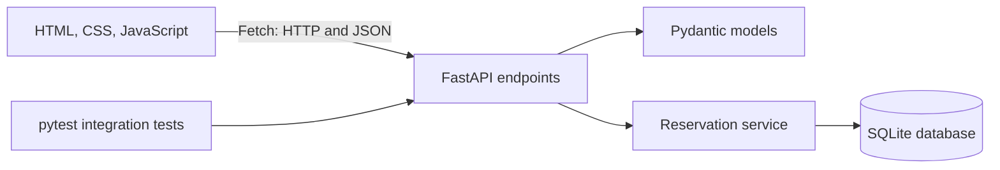

# Laboratory Reservation System

An educational full-stack application for creating and managing laboratory reservations. It connects a browser-based interface to a REST API built with FastAPI and Pydantic, with SQLite persistence.

<div align="center">

**Choose your language / Escolha seu idioma:**

[](README.md)
[](README.pt-BR.md)

</div>


## Table of Contents

- [Overview](#overview)
- [Features](#features)
- [Architecture](#architecture)
- [Technology Stack](#technology-stack)
- [Project Structure](#project-structure)
- [Getting Started](#getting-started)
- [API Reference](#api-reference)
- [Running Tests](#running-tests)
- [Guided Learning Path](#guided-learning-path)
- [Suggested Exercise](#suggested-exercise)

## Overview

This project demonstrates how the parts of a small full-stack application work together:

```text
HTML/CSS -> JavaScript and Fetch -> HTTP/JSON -> FastAPI/Pydantic -> service layer -> SQLite
```

The frontend is served separately from the backend. The browser sends JSON requests to the API, Pydantic validates request data, the service layer applies reservation rules, and SQLite stores the records.

## Features

- Create, list, view, update, and delete laboratory reservations.
- Filter reservations by status and laboratory name.
- Validate reservation fields and allowed status/shift values.
- Prevent active reservations from using the same laboratory, date, and shift. Cancelled reservations do not block the time slot.
- Return clear HTTP status codes for successful requests, invalid input, missing reservations, and scheduling conflicts.
- Explore and try the API through the automatically generated Swagger UI.

## Architecture



The frontend and API run as separate local servers. The API allows requests from `http://localhost:5500` and `http://127.0.0.1:5500`, which are the origins used by the documented frontend command.

## Technology Stack

| Area | Technology | Purpose |
| --- | --- | --- |
| Frontend | HTML, CSS, JavaScript | Reservation form, filters, and results table |
| HTTP client | Fetch API | Sends requests and receives JSON |
| Backend | Python, FastAPI | REST endpoints and HTTP responses |
| Validation | Pydantic | Request and response data contracts |
| Persistence | SQLite | Local reservation storage |
| Tests | pytest, FastAPI TestClient, HTTPX | API integration tests |

## Project Structure

```text
.
├── backend/
│   ├── database.py       # SQLite connection and table creation
│   ├── main.py           # FastAPI app, routes, CORS, and HTTP errors
│   ├── models.py         # Pydantic request and response models
│   ├── requirements.txt  # Python dependencies
│   └── services.py       # CRUD operations, filters, and conflict rule
├── frontend/
│   ├── app.js            # Fetch calls and DOM interactions
│   ├── index.html        # Reservation form and listing
│   └── styles.css        # Page styling and responsive layout
├── tests/
│   └── test_api.py       # API integration tests
├── README.md             # English documentation
└── README.pt-BR.md       # Portuguese documentation
```

The SQLite database file (`backend/reservas.db`) is created automatically when the API starts and is intended for local use.

## Getting Started

### Prerequisites

- Python 3.10 or newer.
- PowerShell on Windows, or a terminal with equivalent virtual-environment commands.

### 1. Create the backend environment

From the repository root, run:

```powershell
cd backend
py -m venv .venv
.\.venv\Scripts\Activate.ps1
python -m pip install -r requirements.txt
```

If PowerShell blocks activation scripts, either use a terminal where activation is permitted or call the environment's Python directly: `\.venv\Scripts\python.exe -m pip install -r requirements.txt`.

### 2. Start the API

In the `backend` directory, run:

```powershell
uvicorn main:app --reload
```

The API is available at `http://127.0.0.1:8000`. Interactive API documentation is at `http://127.0.0.1:8000/docs`.

### 3. Start the frontend

Open a second terminal at the repository root and run:

```powershell
cd frontend
py -m http.server 5500
```

Open `http://localhost:5500` in your browser. Keep both servers running while using the application.

## API Reference

All routes use the `/api/reservas` base path.

| Method | Route | Description | Success |
| --- | --- | --- | --- |
| `POST` | `/api/reservas` | Create a reservation | `201 Created` |
| `GET` | `/api/reservas` | List reservations; optionally filter by `status` and `laboratorio` | `200 OK` |
| `GET` | `/api/reservas/{reserva_id}` | Get one reservation | `200 OK` |
| `PUT` | `/api/reservas/{reserva_id}` | Replace a reservation's editable fields | `200 OK` |
| `DELETE` | `/api/reservas/{reserva_id}` | Delete a reservation | `204 No Content` |

Allowed shifts are `manha`, `tarde`, and `noite`. Allowed statuses are `confirmada`, `pendente`, and `cancelada`. The `data` field uses the ISO date format `YYYY-MM-DD`.

Example request body:

```json
{
	"laboratorio": "Lab 01",
	"responsavel": "Ana",
	"data": "2026-10-10",
	"turno": "manha",
	"finalidade": "Practical class",
	"status": "confirmada"
}
```

Example filtered request: `GET /api/reservas?status=confirmada&laboratorio=Lab`.

Common error responses include `422 Unprocessable Entity` for invalid input, `404 Not Found` when a reservation does not exist, and `409 Conflict` when an active reservation already occupies that laboratory, date, and shift.

## Running Tests

Install the dependencies as described above, then run from the repository root:

```powershell
python -m pytest
```

The integration tests cover reservation creation and retrieval, scheduling conflicts, invalid shifts, laboratory filtering, and deletion behavior.

## Guided Learning Path

Follow the request through the application in this order:

1. `backend/database.py`: SQLite connection, table, and persistence.
2. `backend/models.py`: request/response contracts and structural validation.
3. `backend/services.py`: CRUD, filtering, SQL, and conflict rules.
4. `backend/main.py`: endpoints, HTTP status codes, and exception translation.
5. `frontend/index.html` and `frontend/styles.css`: form, table, and presentation.
6. `frontend/app.js`: JavaScript objects, JSON, Fetch, and DOM updates.
7. `tests/test_api.py`: integration scenarios for the API.

## Suggested Exercise

Add a `quantidade_de_alunos` field with a valid range of 1 to 40. Carry it through the HTML form, JavaScript request body, Pydantic models, SQLite table, SQL statements, API response, and tests. Consider how an existing local database should be migrated when adding a column.
