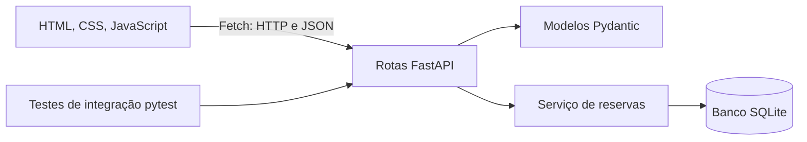

# Sistema de Reservas de Laboratórios

Uma aplicação didática full stack para criar e gerenciar reservas de laboratórios. O projeto conecta uma interface no navegador a uma API REST feita com FastAPI e Pydantic, com persistência em SQLite.

**Escolha seu idioma / Choose your language:**

[](README.md)
[](README.pt-BR.md)


## Sumário

- [Visão geral](#visão-geral)
- [Funcionalidades](#funcionalidades)
- [Arquitetura](#arquitetura)
- [Tecnologias](#tecnologias)
- [Estrutura do projeto](#estrutura-do-projeto)
- [Como executar](#como-executar)
- [Referência da API](#referência-da-api)
- [Testes](#testes)
- [Sequência guiada](#sequência-guiada)
- [Exercício sugerido](#exercício-sugerido)

## Visão geral

O projeto demonstra como as partes de uma aplicação full stack pequena trabalham juntas:

```text
HTML/CSS -> JavaScript e Fetch -> HTTP/JSON -> FastAPI/Pydantic -> camada de serviço -> SQLite
```

O frontend é servido separadamente do backend. O navegador envia requisições JSON para a API, o Pydantic valida os dados, a camada de serviço aplica as regras das reservas e o SQLite armazena os registros.

## Funcionalidades

- Criar, listar, consultar, atualizar e excluir reservas de laboratórios.
- Filtrar reservas por status e nome do laboratório.
- Validar campos da reserva e os valores permitidos para turno e status.
- Impedir reservas ativas para o mesmo laboratório, data e turno. Reservas canceladas não bloqueiam o horário.
- Retornar códigos HTTP para sucesso, dados inválidos, reserva inexistente e conflito de horário.
- Explorar e testar a API pela interface Swagger gerada automaticamente.

## Arquitetura



Frontend e API executam em servidores locais separados. A API permite requisições das origens `http://localhost:5500` e `http://127.0.0.1:5500`, usadas pelo comando do frontend documentado aqui.

## Tecnologias

| Área | Tecnologia | Uso |
| --- | --- | --- |
| Frontend | HTML, CSS, JavaScript | Formulário, filtros e tabela de reservas |
| Cliente HTTP | Fetch API | Envia requisições e recebe JSON |
| Backend | Python, FastAPI | Endpoints REST e respostas HTTP |
| Validação | Pydantic | Contratos de entrada e saída |
| Persistência | SQLite | Armazenamento local das reservas |
| Testes | pytest, FastAPI TestClient, HTTPX | Testes de integração da API |

## Estrutura do projeto

```text
.
├── backend/
│   ├── database.py       # Conexão SQLite e criação da tabela
│   ├── main.py           # Aplicação FastAPI, rotas, CORS e erros HTTP
│   ├── models.py         # Modelos Pydantic de entrada e saída
│   ├── requirements.txt  # Dependências Python
│   └── services.py       # CRUD, filtros e regra de conflito
├── frontend/
│   ├── app.js            # Chamadas Fetch e interação com o DOM
│   ├── index.html        # Formulário e listagem de reservas
│   └── styles.css        # Estilos e layout responsivo
├── tests/
│   └── test_api.py       # Testes de integração da API
├── README.md             # Documentação em inglês
└── README.pt-BR.md       # Documentação em português
```

O arquivo SQLite (`backend/reservas.db`) é criado automaticamente quando a API inicia e é destinado ao uso local.

## Como executar

### Pré-requisitos

- Python 3.10 ou superior.
- PowerShell no Windows ou um terminal com comandos equivalentes para ambientes virtuais.

### 1. Criar o ambiente do backend

Na raiz do repositório, execute:

```powershell
cd backend
py -m venv .venv
.\.venv\Scripts\Activate.ps1
python -m pip install -r requirements.txt
```

Se o PowerShell bloquear a ativação de scripts, use um terminal que permita a ativação ou chame diretamente o Python do ambiente: `\.venv\Scripts\python.exe -m pip install -r requirements.txt`.

### 2. Iniciar a API

No diretório `backend`, execute:

```powershell
uvicorn main:app --reload
```

A API estará em `http://127.0.0.1:8000`. A documentação interativa fica em `http://127.0.0.1:8000/docs`.

### 3. Iniciar o frontend

Abra um segundo terminal na raiz do repositório e execute:

```powershell
cd frontend
py -m http.server 5500
```

Abra `http://localhost:5500` no navegador. Mantenha os dois servidores em execução enquanto usa a aplicação.

## Referência da API

Todas as rotas usam o caminho base `/api/reservas`.

| Método | Rota | Descrição | Sucesso |
| --- | --- | --- | --- |
| `POST` | `/api/reservas` | Criar uma reserva | `201 Created` |
| `GET` | `/api/reservas` | Listar reservas; aceita filtros `status` e `laboratorio` | `200 OK` |
| `GET` | `/api/reservas/{reserva_id}` | Consultar uma reserva | `200 OK` |
| `PUT` | `/api/reservas/{reserva_id}` | Substituir os campos editáveis de uma reserva | `200 OK` |
| `DELETE` | `/api/reservas/{reserva_id}` | Excluir uma reserva | `204 No Content` |

Os turnos aceitos são `manha`, `tarde` e `noite`. Os status aceitos são `confirmada`, `pendente` e `cancelada`. O campo `data` usa o formato ISO `AAAA-MM-DD`.

Exemplo de corpo de requisição:

```json
{
  "laboratorio": "Lab 01",
  "responsavel": "Ana",
  "data": "2026-10-10",
  "turno": "manha",
  "finalidade": "Aula prática",
  "status": "confirmada"
}
```

Exemplo de consulta com filtros: `GET /api/reservas?status=confirmada&laboratorio=Lab`.

Respostas de erro comuns: `422 Unprocessable Entity` para dados inválidos, `404 Not Found` quando a reserva não existe e `409 Conflict` quando já há uma reserva ativa para o laboratório, data e turno informados.

## Testes

Instale as dependências conforme descrito acima e execute na raiz do repositório:

```powershell
python -m pytest
```

Os testes de integração cobrem criação e consulta, conflito de horário, turno inválido, filtro por laboratório e comportamento da exclusão.

## Sequência guiada

Percorra uma requisição nesta ordem:

1. `backend/database.py`: conexão SQLite, tabela e persistência.
2. `backend/models.py`: contratos de entrada/saída e validação estrutural.
3. `backend/services.py`: CRUD, filtros, SQL e regras de conflito.
4. `backend/main.py`: endpoints, códigos HTTP e tradução de exceções.
5. `frontend/index.html` e `frontend/styles.css`: formulário, tabela e apresentação.
6. `frontend/app.js`: objetos JavaScript, JSON, Fetch e atualização do DOM.
7. `tests/test_api.py`: cenários de integração da API.

## Exercício sugerido

Adicione o campo `quantidade_de_alunos`, aceitando valores de 1 a 40. Leve-o pelo formulário HTML, corpo da requisição JavaScript, modelos Pydantic, tabela SQLite, comandos SQL, resposta da API e testes. Considere como migrar um banco local que já exista ao adicionar uma coluna.
